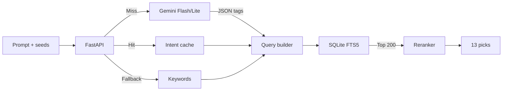

# Koma

A manga, manhwa, and manhua recommender that turns a plain English craving into catalog-backed picks — without letting an AI invent titles.


Demo: `[LIVE_DEMO_URL]`

## The problem

I love stories, and finding the next good manga, manhwa, or manhua takes way more work than it should.

Most sites recycle whatever is already popular. Japanese manga dominates every feed, while Korean manhwa, Chinese manhua, older completed runs, and niche picks get buried — or quietly axed because nobody talked about them while they ran.

So you end up on Reddit. Readers there actually have great taste when they reply, and skimming five threads can hand you two gems. Just as often, your post sits unanswered, gets a reply three days late, or gets brushed off with "just Google it" — which hands back generic lists unless you already search like a power user. Good recommenders exist; they just aren't waiting on call when you finish a series at 2 a.m.

Checkbox tag filters don't solve this either. Nobody thinks in database slugs; you think *"a betrayed tycoon gets a second chance and takes revenge"*. Even then, you hit practical walls: the pick turns out to be a oneshot, has no official English release, or jumps straight into explicit 18+ scenes you never wanted.

More people should read real stories instead of recycled lists, so I built Koma to bridge that gap.

## What it does

Describe what you feel like reading (plus up to three series you liked), and Koma converts that into structured filters over 180,302 indexed works, returning 13 ranked picks with tag chips explaining each match. Switching filters runs on the database with zero extra AI calls, leaving the rest of the interface for the app showcase.

**Real query & output** (run locally, `62 ms` DB time across `1,502` matching manhwa):

> **Prompt:** *"Manhwa with a unique, gritty art style and storytelling — something different from the usual mainstream"*  
> **Intent:** `must`: `dark_ambience` · `boosts`: `psychological`, `anti_hero`, `suspense`  
> **Top 5 (Manhwa filter):** **1.** PIGPEN *(completed, 8.1)* · **2.** Superior Day *(completed, 7.0)* · **3.** It's Mine *(completed, 7.5)* · **4.** The Crimson Lady *(completed, 7.3)* · **5.** Bastard *(completed, 8.5)*

Across all origins (`All`, `124 ms`), Japanese horror *Shiki* takes slot #5; flipping to `Manhwa` swaps it for *Bastard* in `62 ms` with zero extra AI calls.

## Screenshots

`[SCREENSHOT / GIF PLACEHOLDER: Capture (1) the dark hero mosaic with a query and seed title typed in, and (2) the 13-card grid showing the "Understood as" tag chips and filter toggles.]`

## How it works

**The AI never names a title.** Gemini only turns your sentence into allowed tags, keywords, exclusions, and flags; SQLite does the searching and ranking, so Koma cannot hallucinate a series that doesn't exist.



**Data.** Built from [MangaBaka](https://mangabaka.org)'s 565,796-record dump across seven databases. Real metadata is messy: 258,805 rows are merged stubs (`306,991` live), 41% lack clean tags, 34% lack synopses, 116,774 (20.6%) lack *both*, and 48.8% have no rating. Keeping live manga (`149,257`), manhwa (`19,038`), and manhua (`12,007`) with searchable text — while dropping `pornographic` works — yields 180,302 series in [`backend/build_db.py`](backend/build_db.py) (an earlier safe+suggestive build on disk holds 152,863).

**Taxonomy.** Of 6,421 raw tags (`126` appear once), keeping those with 100+ records and stripping demographic clutter gives 1,698 canonical tags (`1,422` in the earlier build), weighted `core` > `defining` > `recurrent`. Unknown tags from the model are dropped.

**Search & ranking.** SQLite FTS5 (built-in full-text search) indexes tags and 60-word-median synopses via BM25 (scoring rare matches above common filler). Queries soften across three stages (strict `must` -> scored `OR` -> keywords), and a reranker scores the top 200 candidates by BM25, tag overlap, format/status cues, filled ratings, and a small popularity nudge down to 13 picks.

**Filters & seeds.** Toggling origin type, length (`oneshot`, `short series`, `series`), `Official English only`, or suggestive/18+ filters hits `/refilter` via FTS5 flag tokens — zero AI calls. Naming up to three "like X" titles resolves aliases (`title_aliases`), pulls defining tags, and drops the seed itself.

## What I learned

- **Keep AI out of title naming.** Asking an LLM for titles directly hallucinated series names and mixed anime with manga. Restricting it to JSON filter extraction ended hallucinations — and showed that even at `temperature=0`, live Gemini runs matched `must` tags only 58.3% of the time across 24 queries, making intent caching essential.
- **Measure startup latency first.** Early calls dragged on Gemini's interactions client. `latency_probe.py` exposed `store=True` persistence overhead; switching to stateless `models.generate_content` fixed it.
- **Separate intent from SQL filters.** Caching `intent_id` in `state_v1.sqlite` makes filter switches run in milliseconds instead of waiting seconds and burning quota per click.
- **Spread load across models.** `ModelLoadBalancer` balances RPM/RPD across five Gemini Flash/Lite tiers, fires a hedged retry after `3.5 s`, cools down `429`/`503`/`404` failures, and falls back to keyword search offline.
- **Embeddings didn't fix trope search.** Testing local CPU sentence embeddings (`BAAI/bge-small-en-v1.5`) on 7,141 docs (`test_dense_embedding_diagnostic.py`) put just 1 of 12 relevant Reddit picks in the catalog top 200 — blurbs narrate plot events while readers ask for meta-tropes.
- **Enforce adult gates server-side.** `backend/build_db.py` drops `pornographic` works (`0` indexed), and SQL defaults hide `suggestive`/`erotica` unless unlocked via explicit opt-in, an 18+ modal, and cover blur.

## How I tested it

Early self-curated evaluations — not formal benchmarks:

- **Tests & build:** 11 `pytest` tests in [`backend/test_api.py`](backend/test_api.py) pass (`1.17 s`), covering safety locks, rating combinations, caching, `/refilter`, aliases, quota fallback, rate limits, and failover; Vite + TypeScript builds clean.
- **24 Reddit requests (`eval_graded_baselines.py`):** Across 23 non-explicit queries graded 0–3 (`>= 2` = relevant) by a unified LLM judge, expanding candidates to 200 with reranking moved strict Precision@5 from **38.3% -> 60.0%** (enforcing manga/manhwa format) and **66.1% -> 74.8%** (story only) — vs **10.4% / 23.5%** for popularity sorting and **7.0% / 20.0%** for rating sorting. (Earlier human grading across 308 pairs averaged `1.05–1.16 / 3`.)
- **12 held-out queries (`eval_held_out_queries.py`):** Judged at **58.3% P@5** (with format) and **73.3%** (story only), vs **1.7% / 3.3%** for popularity sorting.
- **Exact-title smoke checks:** Reproducing the 8-query `golden_test.py` check hits **25% Recall@10**; Hit@10 on 12 Reddit threads (`manhwa_rec_eval.json`) is **1/12 (8.3%)**. Auditing those 37 Reddit commenter recs showed why: only **32.4% (12/37)** actually matched every constraint the poster asked for.
- **Speed:** Warm DB search + rerank measured **36–62 ms** for focused queries (`3.8–103 ms` in `exploratory.ipynb` raw checks); cached queries and `/refilter` use `0 ms` of model time.

**Weaknesses:** Broad vibe requests (*"something good"*) slip toward generic picks, and art-style prompts can only map to mood tags (`dark_ambience`) rather than visual line art. Relationship-direction prompts (*"popular girl falls for quiet loner first"*) stay brittle when gender-neutral tags (`unpopular_protagonist`) let reverse dynamics into top results. Roughly 41% of raw records lack tags, hiding valid series unless synopses catch them.

## Run it yourself

Requires Python 3.12+, Node.js 18+, and optionally a free [Google AI Studio](https://aistudio.google.com/) key (never commit keys; keyword fallback works offline).

```bash
git clone https://github.com/[YOUR-USERNAME]/[YOUR-REPO].git && cd [YOUR-REPO]
python -m venv .venv && source .venv/bin/activate
pip install -r backend/requirements.txt
export GEMINI_API_KEY="your-gemini-api-key"

# Build catalog (requires local MangaBaka series_slim.jsonl & series_avail.jsonl)
DB_PATH=backend/catalog_v1.sqlite TAXONOMY_PATH=backend/taxonomy_v1.json python backend/build_db.py
export CORS_ORIGINS="http://localhost:5173,http://127.0.0.1:5173"
uvicorn backend.api:app --host 0.0.0.0 --port 8000 --reload
```

Frontend (`http://localhost:5173`) — or set `VITE_MOCK=1` in `frontend/.env` to preview without building the 260 MB database:

```bash
cd frontend && cp .env.example .env && npm install && npm run dev
```

Tests: `.venv/bin/python -m pytest backend/test_api.py -v` and `cd frontend && npm run build`.

## Tech stack

| Layer | Tools |
|:------|:------|
| Backend | Python 3.12, FastAPI, Pydantic v2, SQLite FTS5 + BM25, `google-genai` |
| Frontend | React 18, TypeScript, Vite 5, Tailwind CSS 3 |
| AI routing | Gemini Flash/Lite (`ModelLoadBalancer`, `3.5 s` hedging, lexical fallback) |
| Metadata | [MangaBaka](https://mangabaka.org) open dump (`180,302` works, `1,698` tags) |

## What's next

- Use stored `/feedback` votes and notes to tune reranking weights.
- Clean tag synonyms (`suggest_synonyms.py`) and grow a multi-rater eval set.
- Add persistent reading lists so returning readers aren't re-typing favorites.
- Find affordable hosting for the ~260 MB SQLite index (`[LIVE_DEMO_URL]`).
- Automatic import of file dumps from mangabaka for upto date titles.

**Data & attribution:** Metadata comes from **[MangaBaka](https://mangabaka.org)** ([CC BY-NC-SA 4.0](https://creativecommons.org/licenses/by-nc-sa/4.0/)), cross-referencing [MangaUpdates](https://www.mangaupdates.com), [AniList](https://anilist.co), [MyAnimeList](https://myanimelist.net), [Anime-Planet](https://www.anime-planet.com), [Kitsu](https://kitsu.app), [Shikimori](https://shikimori.one), and [Anime News Network](https://www.animenewsnetwork.com). Koma is non-commercial and hosts metadata only — no chapters or scans.

---

<div align="center">
  <sub>Built by Chai · More time to read, less to search.</sub>
</div>
