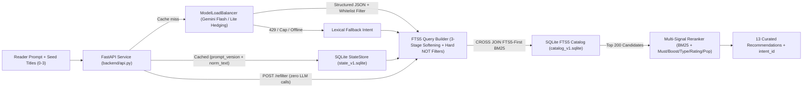

<div align="center">

<h1>KOMA</h1>
<h2>Semantic Manga, Manhwa &amp; Manhua Recommender</h2>

<p>
  <strong>Describe a trope, plot twist, character dynamic, or favorite series in plain English — get 13 tailored recommendations in sub-second SQLite queries, then refilter instantly with zero extra AI calls.</strong>
</p>

<p>
  
  
  
  
</p>

<p>
  <a href="#why-koma"><strong>Why Koma</strong></a> ·
  <a href="#data-credits"><strong>Data Credits &amp; Citations</strong></a> ·
  <a href="#architecture"><strong>Architecture</strong></a> ·
  <a href="#catalog-stats"><strong>Catalog Stats</strong></a> ·
  <a href="#quickstart"><strong>Quickstart</strong></a> ·
  <a href="#api-reference"><strong>API</strong></a>
</p>

</div>

---

<a id="why-koma"></a>

# ✨ Why Koma? (Core USPs)

<h2>1. 🎯 Understands Specific Tropes — Not Just Generic Genres</h2>

There are  (e.g., *"regression revenge story of a betrayed tycoon"* or *"male lead falls first for an unpopular girl, no BL"*) into structured constraints across **1,698 canonical tags** weighted by story importance (`core > defining > recurrent`):

- **`must_have_tags` vs. `boost_tags`:** Isolates the defining premise separately from supporting mood/setting tags instead of diluting results with generic labels.
- **Community Lingo Aware:** Distinguishes reader terms like *"regression / regressor / returner"* (`time_rewind` + regressor tags) from unrelated tags (`age_regression`).
- **Hard Negative Exclusions:** Honors exclusions like `"no BL"`, `"no harem"`, or `"without romance"`, and omits series the reader says they already read.
- **3-Stage Softening Fallback:** Starts strict (`must` AND `boost`/`keywords`), softens to scored OR matching if too narrow, and falls back to synopsis keywords so you rarely hit dead-end empty pages.

<h2>2. ⚡ Instant Zero-AI Refiltering</h2>

Your initial query mints a cached `intent_id` stored on disk in `state_v1.sqlite`. Switching between:
- **Origin Type:** `All` · `Manhwa` · `Manga` · `Manhua`
- **Format:** `Any format` · `One-shot` · `Short series` · `Full series`
- **Accessibility & Safety:** `Official English only` · `Include suggestive` · `18+ content`

hits `POST /refilter` directly against indexed SQLite FTS5 flag tokens (`type_*`, `rating_*`, `fmt_*`, `read_*`) and `CROSS JOIN` FTS5-first execution — **costing 0 Gemini API calls** and returning updated results in milliseconds.

<h2>3. 🌱 Seed-Title Anchoring ("I liked..." up to 3 Titles)</h2>

Already love a series? Add up to 3 anchor titles in the UI (or pass `seed_titles` to `/recommend`, or name them inline like *"like ORV but with a female lead"*):
- Resolves English, romanized, Japanese, Korean, and associated names via a normalized `title_aliases` index built from MangaBaka `titles` and MangaUpdates `secondary_titles`.
- Extracts the highest-priority, non-generic defining tags from your seed titles (`core`/`defining` weighted above boilerplate metadata like `full_color` or `south_korea`).
- Excludes the seed titles themselves from your results and reports any unrecognized seed names cleanly in a UI banner instead of failing the request.

<h2>4. 🛡️ Resilient Multi-Model Gemini Routing + Offline Fallback</h2>

AI extraction stays fast and dependable even under tight free-tier quotas:
- **Least-Loaded Model Balancer:** Thread-safe `ModelLoadBalancer` tracks rolling per-minute (`RPM`) and daily (`RPD`) traffic across Gemini Flash/Lite models, routing each call to the lowest-load healthy tier.
- **Hedged Execution & Cooldowns:** If the primary model stalls past `3.5s`, Koma launches a hedged backup call up to a `12s` total timeout and puts `429` / `503` / `404` models on targeted cooldowns.
- **Zero-Crash Lexical Fallback:** If all LLM calls hit quota caps (`GEMINI_DAILY_CAP`) or upstream errors, Koma falls back cleanly to `lexical_intent` keyword/slug matching and marks `degraded: true` in the response.

<h2>5. 🔒 Built-In Content Safety & Opt-In 18+ Controls</h2>

- **`pornographic` Excluded at Index Time:** `backend/build_db.py` drops `pornographic` works completely before creating `catalog_v1.sqlite` (`0` indexed).
- **Safe by Default:** Both `Include suggestive` and `18+ content` default to `false` server-side and client-side.
- **Age Gate & Blurred Covers:** Enabling `18+ content` triggers a confirmation modal persisted in `localStorage`, and `suggestive` / `erotica` covers stay blurred behind a **"Tap to reveal"** overlay.

<h2>6. 🎨 Reader-First Discovery UI</h2>

- **Curated Poster Backdrop:** Tilted, blurred hero mosaic served locally from `frontend/public/posters/` featuring a 50/50 mix of iconic hits and lesser-known `safe` manga & manhwa.
- **13 Ranked Matches + Explainable Chips:** Displays `Understood as` tag chips (`must` vs. `boosts`) and real AI/DB latency alongside 13 ranked cards.
- **Dedicated Searchable `/faqs` Page:** Full client-side navigation (`/`, `/faqs`) with topic pills, keyword filtering, expand/collapse controls, and light/dark themes.
- **Actionable Cards & Feedback Loop:** Click any unblurred card to search Google (`"<title> read"`) in a new tab, and record thumbs up/down votes + optional one-line notes via `POST /feedback`.

---

<a id="data-credits"></a>

# 🙏 Data Credits & Citations

Koma is a **non-commercial metadata search and discovery project**. It does **not** host, mirror, scrape, or distribute copyrighted chapters or scanlations.

<h2>Built on Open Community Metadata from MangaBaka</h2>

All series records, tag taxonomies (`1,698` canonical tags with `core`/`defining`/`recurrent` weights), content ratings, alternate titles, publication availability metadata, and cover links in this catalog originate from the open dataset compiled by **[MangaBaka](https://mangabaka.org)** (licensed under **[CC BY-NC-SA 4.0](https://creativecommons.org/licenses/by-nc-sa/4.0/)**).

Special thanks to **MangaBaka** for cleaning, deduplicating, normalizing ratings, and unifying metadata across the broader manga tracking ecosystem into one open resource.

<h2>Upstream Databases Cross-Referenced in the Dataset</h2>

The `series.json` metadata export aggregates and links entries from the following upstream community databases (`source` mappings and `secondary_titles` in the raw export). We gratefully credit their communities, moderators, and maintainers for years of cataloging work:

| # | Database | Link | Role in Aggregated Dataset |
| :-: | :--- | :--- | :--- |
| **1** | **MangaUpdates (Baka-Updates)** | [mangaupdates.com](https://www.mangaupdates.com) | Series metadata, normalized ratings (`source.manga_updates`), associated alternate titles (`secondary_titles`), and release tracking |
| **2** | **AniList** | [anilist.co](https://anilist.co) | Cross-referenced catalog IDs, community scores (`source.anilist`), and metadata attributes |
| **3** | **MyAnimeList (MAL)** | [myanimelist.net](https://myanimelist.net) | Community catalog IDs, scores (`source.my_anime_list`), and reference mappings |
| **4** | **Anime-Planet** | [anime-planet.com](https://www.anime-planet.com) | Community ratings (`source.anime_planet`), tag ecosystem, and series cross-links |
| **5** | **Kitsu** | [kitsu.app](https://kitsu.app) / [kitsu.io](https://kitsu.io) | Normalized community ratings (`source.kitsu`) and series mappings |
| **6** | **Shikimori** | [shikimori.one](https://shikimori.one) | Cross-referenced catalog IDs and normalized ratings (`source.shikimori`) |
| **7** | **Anime News Network (ANN)** | [animenewsnetwork.com](https://www.animenewsnetwork.com) | Encyclopedia IDs (`source.anime_news_network`), metadata, and synopses |

<sub>Note: In a 5,000-record check of the raw export, source link coverage spanned MangaUpdates (`4,916`), Anime-Planet (`4,626`), AniList (`4,601`), MyAnimeList (`4,071`), Shikimori (`4,030`), Kitsu (`3,763`), and Anime News Network (`1,873`), unified under canonical MangaBaka records.</sub>

### Suggested Attribution & Citation

If you reuse or fork this repository's metadata pipeline, please preserve attribution to **MangaBaka** (`CC BY-NC-SA 4.0`) and its upstream sources:

```text
Metadata powered by MangaBaka (https://mangabaka.org), licensed under CC BY-NC-SA 4.0,
with aggregated catalog metadata cross-referenced from MangaUpdates, AniList, MyAnimeList,
Anime-Planet, Kitsu, Shikimori, and Anime News Network.
```

```bibtex
@misc{mangabaka_dataset,
  title        = {MangaBaka Open Manga, Manhwa, Manhua & Light Novel Metadata Database},
  author       = {{MangaBaka Contributors}},
  url          = {https://mangabaka.org},
  note         = {CC BY-NC-SA 4.0. Aggregates metadata cross-referenced from MangaUpdates, AniList, MyAnimeList, Anime-Planet, Kitsu, Shikimori, and Anime News Network.}
}
```

---

<a id="architecture"></a>

# 🏗️ Architecture & Ranking Pipeline



---

<a id="catalog-stats"></a>

# 📊 Catalog Breakdown

Counts below are verified directly against the in-scope filter rules in [`backend/build_db.py`](backend/build_db.py) over the `565,796`-record export (`MIN_TAG_RECORDS = 100`, `merged_with` excluded, `pornographic` excluded):

| Dimension | Breakdown | Count |
| :--- | :--- | ---: |
| **Raw Export** | Total records in `series_slim.jsonl` | **565,796** |
| **In-Scope Catalog** | Indexed into `catalog_v1.sqlite` | **180,302** |
| **Origin Types** | Manga / Manhwa / Manhua | `149,257` / `19,038` / `12,007` |
| **Content Ratings** | Safe / Suggestive / Erotica / Pornographic | `143,223` / `9,640` / `27,439` / **`0`** |
| **Tag Taxonomy** | Canonical tags in [`backend/taxonomy_v1.json`](backend/taxonomy_v1.json) | **1,698** |

---

<a id="quickstart"></a>

# 🚀 Quickstart

### Prerequisites
- **Python 3.12+** (backend uses FastAPI, Uvicorn, Pydantic v2, `google-genai`, `ijson`, `pytest`)
- **Node.js 18+** & **npm** (frontend uses React 18, TypeScript, Vite 5, Tailwind CSS 3)
- *(Optional)* A **Gemini API key** (`GEMINI_API_KEY`) — without one, the backend automatically uses offline `lexical_intent` fallback, or the frontend can run in `VITE_MOCK=1` preview mode.

### 1. Clone & Configure Environment

```bash
git clone https://github.com/<your-username>/<your-repo>.git
cd <your-repo>
```

Set your Gemini API key cleanly via environment variable (never commit `.env` or key files):

```bash
export GEMINI_API_KEY="your-gemini-api-key"
```

### 2. Build the Catalog Database *(Requires Local MangaBaka Export Files)*

Because `catalog_v1.sqlite` exceeds GitHub's 100 MB file limit, keep raw exports (`series_slim.jsonl`, `series_avail.jsonl`, and optionally `series.json` for extra alternate aliases) locally and build the SQLite FTS5 catalog with:

```bash
python -m venv .venv
source .venv/bin/activate
pip install -r backend/requirements.txt

# Builds catalog_v1.sqlite and taxonomy_v1.json (override paths via DB_PATH / TAXONOMY_PATH)
DB_PATH=backend/catalog_v1.sqlite TAXONOMY_PATH=backend/taxonomy_v1.json python backend/build_db.py
```

### 3. Start the Backend API

```bash
source .venv/bin/activate
export CORS_ORIGINS="http://localhost:5173,http://127.0.0.1:5173"
uvicorn backend.api:app --host 0.0.0.0 --port 8000 --reload
```

Or run via Docker (mounting a `/data` volume containing `catalog_v1.sqlite` and `taxonomy_v1.json`):

```bash
docker build -t koma-api ./backend
docker run -p 8000:8000 \
  -v /path/to/data:/data \
  -e GEMINI_API_KEY="your-gemini-api-key" \
  -e CORS_ORIGINS="http://localhost:5173" \
  koma-api
```

See [`backend/README.md`](backend/README.md) for all backend environment variables (`DB_PATH`, `CACHE_DB_PATH`, `GEMINI_DAILY_CAP`, `RATE_LIMIT_PER_MIN`, `TRUST_PROXY`).

### 4. Start the Frontend (`http://localhost:5173`)

```bash
cd frontend
cp .env.example .env
npm install
npm run dev
```

To preview the frontend UI without a running backend, set `VITE_MOCK=1` in `frontend/.env`. Vite proxies `/recommend`, `/refilter`, `/feedback`, and `/health` to `http://localhost:8000` automatically via [`frontend/vite.config.ts`](frontend/vite.config.ts).

---

<a id="api-reference"></a>

# 🔌 API Reference

| Method | Endpoint | Purpose |
| :--- | :--- | :--- |
| `POST` | `/recommend` | Extracts intent (Gemini or cached/lexical fallback), resolves `seed_titles`, ranks & returns up to `13` titles + `intent_id`. |
| `POST` | `/refilter` | Re-queries an existing `intent_id` with updated filters (`type`, `format`, `readable_only`, `include_suggestive`, `include_mature`, `offset`) without calling the LLM. |
| `POST` | `/feedback` | Persists thumbs up/down (`1` / `-1`) and optional 1-line note (`max_length=200`) into `state_v1.sqlite`. |
| `GET` | `/health` | Reports catalog status, indexed record count, and taxonomy tag count. |

---

# 🧪 Verification

Run the isolated backend test suite (builds temporary SQLite fixtures on the fly) and the frontend production build:

```bash
# Backend API & router tests (11 tests)
.venv/bin/python -m pytest backend/test_api.py -v

# Frontend TypeScript check + Vite bundle
cd frontend && npm run build
```

---

# 📁 Project Layout

```text
.
├── backend/
│   ├── api.py                 # FastAPI endpoints, Pydantic schemas, rate limiting, CORS
│   ├── build_db.py            # SQLite + FTS5 catalog & alias builder from MangaBaka exports
│   ├── cache.py               # Persistent SQLite intent cache, sessions, daily cap, feedback store
│   ├── db.py                  # Thread-safe CatalogDB reader, FTS5 CROSS JOIN search, seed resolver
│   ├── router.py              # ModelLoadBalancer, hedged Gemini calls, lexical fallback, reranker
│   ├── taxonomy_v1.json       # 1,698 curated tags sorted by frequency
│   ├── test_api.py            # 11-test pytest suite covering safety, caching, hedging, & refiltering
│   ├── Dockerfile
│   ├── requirements.txt
│   └── README.md
└── frontend/
    ├── public/posters/        # 10 local safe manga & manhwa covers for hero mosaic
    ├── src/
    │   ├── main.tsx
    │   └── index.css
    ├── koma_manga_manhwa_recommender.tsx  # Recommender UI, FilterBar, SeriesCards, & /faqs page
    ├── index.html
    ├── package.json
    ├── tailwind.config.js
    └── vite.config.ts
```

---

<div align="center">
  <sub>Built with love for readers · Metadata courtesy of <strong>MangaBaka</strong> and the open manga community databases above.</sub>
</div>
